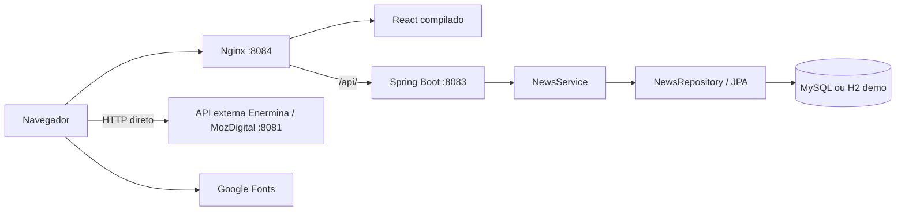

# Descrição técnica completa do Credível

## 1. Escopo

Este documento descreve os ficheiros presentes em `/opt/credivel` em 14/10/2026. As fontes são o código frontend e backend, POM, lockfile npm, configurações Spring e modelos em `deploy`.

A análise é estática: não confirma disponibilidade dos serviços, configuração instalada no servidor, conteúdo persistido, desempenho ou contrato efetivo da API externa. O diretório `data` não foi inspecionado por falta de acesso. As propostas de melhoria não representam funcionalidades existentes.

## 2. Objetivo e capacidades

O Credível apresenta notícias com classificação editorial `CREDIVEL` ou `FALSO`, permite ler artigos completos e mostra publicações provenientes de um sistema externo. A classificação é informada no cadastro: não existe verificação automática, IA ou análise de evidências implementada.

| Capacidade | Comportamento existente |
|---|---|
| Feed de notícias | Artigos publicados, paginação e ordenação por data |
| Destaques | Primeiros três artigos carregados, sem flag editorial |
| Carrossel | Até três resultados, rotação a cada cinco segundos |
| Pesquisa | Filtro local de título, resumo e categoria |
| Detalhe | Imagem, fonte, autor, data, classificação e texto completo |
| Gestão editorial | CRUD por API; sem painel administrativo |
| Rascunhos | Persistidos, omitidos das consultas públicas |
| Visualizações | Contador por consulta individual |
| Comunidade | Leitura de publicações, imagens e vídeos de API externa |
| Login | Credencial fixa e estado no navegador |
| Gostos | Alteração temporária no componente |
| Comentários | Contador e botão sem ação |
| Partilha | Cópia do URL atual para a área de transferência |

## 3. Arquitetura



O frontend é uma SPA renderizada no navegador. O Nginx serve `frontend/dist`, encaminha `/api/` à API preservando o caminho e usa `index.html` como fallback das rotas frontend. As publicações são solicitadas diretamente pelo navegador ao servidor externo; não passam pelo backend local e não são persistidas na tabela de notícias.

O backend divide responsabilidades em controlador HTTP, serviço de negócio e repositório JPA. Não há filas, cache distribuída, tarefas periódicas ou mensageria no projeto.

## 4. Tecnologias

| Tecnologia | Versão ou configuração local |
|---|---|
| Java | 21 no POM |
| Spring Boot | 3.4.4 |
| Spring Web | Dependência gerida pelo Spring Boot |
| Spring Data JPA / Hibernate | Persistência e repositórios |
| Jakarta Validation | Validação dos DTOs |
| MySQL e H2 | Drivers runtime; versão do servidor MySQL não especificada |
| Maven | Wrapper local aponta para 3.9.12 |
| React / React DOM | 19.3.0 no lockfile |
| React Router DOM | 7.18.4 no lockfile |
| Vite | 8.3.0 no lockfile |
| Plugin React | 6.1.1; sem configuração Vite encontrada |
| Nginx / systemd | Modelos de implantação fornecidos |

As versões frontend são as registadas localmente, sem consulta a catálogo externo. `package.json` usa `latest`, mas `npm ci` instala conforme o lockfile. O Vite registado requer Node `^20.19.0 || >=22.12.0`.

## 5. Organização do projeto

```text
backend/
  pom.xml
  mvnw e .mvn/                 # locais, ignorados pelo Git
  src/main/java/org/credivel/
    CredibelApplication.java
    config/                    # CORS, erros e seed
    news/                      # domínio, DTOs e CRUD
  src/main/resources/          # application*.properties
frontend/
  package.json e package-lock.json
  index.html
  public/                      # SVGs e imagens importadas
  src/
    main.jsx e App.jsx
    components/
    pages/
    services/
    styles.css
deploy/                        # systemd e Nginx
data/                          # caminho configurado para H2
docs/                          # documentação
```

A classe de arranque chama-se `CredibelApplication`. O artefacto é `credivel-api-1.0.0.jar`. `target`, `dist` e `node_modules` são resultados gerados, não fontes.

## 6. Componentes backend

| Elemento | Responsabilidade |
|---|---|
| `NewsController` | Rotas `/api/news`, parâmetros e validação de corpo |
| `NewsService` | Publicação, normalização, visibilidade e contagem |
| `NewsRepository` | CRUD e consultas por status e slug |
| `News` | Entidade da tabela `news` e callbacks de timestamp |
| `NewsRequest` | Contrato de criação e atualização |
| `NewsResponse` | Resposta pública completa |
| `NewsClassification` | Enum `CREDIVEL`, `FALSO` |
| `NewsStatus` | Enum `DRAFT`, `PUBLISHED` |
| `NewsNotFoundException` | Sinalização de artigo inexistente ou não público |
| `ApiExceptionHandler` | Respostas JSON de erro |
| `WebConfig` | CORS em `/api/**` |
| `SeedData` | Três artigos fictícios quando a tabela está vazia |

### 6.1 Visibilidade e publicação

A listagem consulta apenas `PUBLISHED`, ordenando `publishedAt` decrescente. A paginação começa em zero; tamanho padrão 12 e máximo 50. O frontend solicita nove itens.

As consultas individuais exigem `PUBLISHED`: um rascunho retorna 404. Atualização e eliminação atuam por ID independentemente do status. Não há endpoint dedicado à listagem de rascunhos.

Ao publicar sem `publishedAt`, o serviço define o instante atual. Isso também acontece ao atualizar um artigo publicado, podendo mudar a sua ordem no feed. Para conservar a data, o cliente deve reenviá-la. Rascunhos podem guardar uma data fornecida. Não existe agendamento: artigos publicados com data futura já são visíveis.

### 6.2 Slugs

Um slug ausente ou em branco é derivado do título. O serviço remove marcas diacríticas, converte para minúsculas, substitui sequências fora de `a-z0-9` por hífen e elimina hífens nas extremidades. Resultado vazio vira `noticia`.

A unicidade é imposta pelo banco; não há geração de sufixo ou tratamento específico de conflito. Uma colisão pode produzir 500. Alterar o título e omitir o slug pode mudar o endereço.

O seed usa outra normalização e preserva alguns caracteres acentuados. O frontend aplica `encodeURIComponent` ao consultar slugs.

### 6.3 Transações e timestamps

Criação, atualização e leitura individual têm `@Transactional`. O JPA grava alterações das entidades geridas no encerramento da transação. A eliminação verifica existência e chama `deleteById`, sem transação de serviço explícita abrangendo ambos os passos.

Cada GET individual incrementa `views`, sem identificação de visitante ou deduplicação. O incremento não é atómico e acessos concorrentes podem perder contagens. `React.StrictMode` pode repetir efeitos em desenvolvimento e causar consultas adicionais.

`@PrePersist` define `updatedAt` se ausente; `@PreUpdate` renova-o em qualquer atualização, inclusive de visualizações. Portanto, esse campo não representa exclusivamente uma revisão editorial. Não existem `createdAt`, versionamento otimista, histórico, auditoria ou exclusão lógica.

### 6.4 Seed

Se `count()>0`, nenhuma amostra é inserida. Caso a tabela esteja vazia, são criados três artigos fictícios publicados, fonte `Laboratório Credível`, autor `Equipa editorial`, imagens SVG e datas relativas ao arranque. O seed executa em qualquer perfil. Apagar todos os registos e reiniciar pode recriar amostras.

## 7. Modelo de dados

O domínio local possui uma entidade persistida, `News`. Não existem relações JPA ou tabelas próprias de utilizadores, comentários e reações. O quadro mostra o modelo lógico: nomes físicos e tipos SQL exatos dependem do Hibernate e não foram inspecionados no banco.

| Campo | Tipo | Obrigatório na entidade | Regra |
|---|---|---|---|
| `id` | Long | Sim | Chave primária, identidade automática |
| `title` | String | Sim | 255 caracteres |
| `slug` | String | Sim | 280, único |
| `summary` | String | Sim | 800 |
| `content` | String/Lob | Sim | Sem limite explícito no DTO |
| `imageUrl` | String | Sim | 1.000 |
| `classification` | Enum String | Sim | 16 |
| `source` | String | Sim | 180 |
| `author` | String | Não | 160 |
| `category` | String | Sim | 100 |
| `status` | Enum String | Sim | 16; entidade inicia com `DRAFT` |
| `views` | long | Sim | Zero inicial |
| `publishedAt` | Instant | Não | Automático ao publicar sem data |
| `updatedAt` | Instant | Sim | Callback de persistência |

Índices declarados: `idx_news_slug`, único sobre slug, e `idx_news_publication`, sobre `status,publishedAt`. A coluna slug também é marcada como única.

`ddl-auto=update` adapta o esquema no arranque. Não há migrações Flyway/Liquibase; essa configuração não substitui um procedimento de migração e recuperação.

## 8. Frontend e navegação

| Rota | Componente | Função |
|---|---|---|
| `/` | `Feed` | Notícias, pesquisa, carrossel e paginação |
| `/news/:slug` | `Detail` | Leitura completa |
| `/publications` | `Publications` | Feed externo |
| `/login` | `Login` | Acesso demonstrativo |

`main.jsx` monta React com `StrictMode` e `BrowserRouter`. `App` apresenta cabeçalho e navegação em todas as páginas. Não há rota curinga 404.

`Header` tenta `/logo.png`; na falha mostra uma marca CSS. O ficheiro não consta dos assets fonte encontrados. `SectionNav` liga Notícias e Publicações. `Classification` mostra Falso apenas para `FALSO`; qualquer outro valor recebe o selo Credível. `NewsCard` usa carregamento diferido de imagem. `Detail` divide o texto por quebras de linha e renderiza parágrafos React, sem interpretar HTML.

### 8.1 Pesquisa e carregamento

A pesquisa normaliza acentos e caixa de título, resumo e categoria. Considera somente artigos já carregados, não pesquisa conteúdo completo, fonte ou autor e não consulta a API. Com pesquisa ativa, o botão de carregar novas páginas fica oculto.

O feed acrescenta páginas ao estado e usa `last` da resposta para controlar o botão. Um listener global intercepta cliques em `.more button` sem sessão e redireciona para `/login`. Após entrar, a página é remontada e recomeça pela primeira página; o clique anterior não é repetido.

Os destaques são os primeiros três artigos da lista original. O carrossel usa os primeiros três resultados filtrados. Há estados de carregamento, erro, lista vazia e pesquisa vazia, além de tentativa novamente para o feed de notícias.

### 8.2 Apresentação

As fontes DM Sans e Newsreader vêm de Google Fonts. A identidade usa azul, verde e vermelho; há breakpoints em vários tamanhos de ecrã, grelha desktop e cartões compactos em mobile. Labels de pesquisa e carrossel existem, mas não foi feita auditoria de acessibilidade. As imagens editoriais têm `alt` vazio.

`public/imported` contém imagens locais; isso não comprova utilização pelo banco. URLs de imagens são carregadas pelo navegador, sem processamento ou verificação local.

## 9. Autenticação e segurança

`auth.js` compara email e senha fixos: `user@credivel.com` / `user123`. Guarda o email em `localStorage`, chave `credivel.session`. Não existem token, expiração, utilizadores no banco ou validação backend. `logout()` existe no serviço, mas não há botão de saída na interface analisada.

O formulário remove espaços das extremidades do email e compara com distinção de maiúsculas. O destino depois do login vem de `from` na query, estado da navegação ou `/`.

Não há Spring Security nem autorização CRUD. Um cliente com acesso à API pode criar, atualizar e apagar notícias. A restrição de carregar mais itens é apenas visual. CORS não protege contra clientes HTTP diretos.

Os erros omitem stacktraces. Não há rate limiting, auditoria, controlo de papéis ou validação de domínio de imagens. `content` não tem tamanho máximo explícito. Limites multipart não constituem um limite geral para corpos JSON.

O modelo Nginx utiliza HTTP. A URL JDBC padrão contém `useSSL=false` e `allowPublicKeyRetrieval=true`. Esses são valores atuais, sem validação de adequação ao ambiente de produção.

## 10. Publicações externas

O frontend fixa o endpoint `http://72.62.234.76:8081/api/enermina/publicacoes/feed?page=0&size=50` e host de media `http://72.62.234.76:8081`. Não usa variável de ambiente ou token nessa chamada.

Aceita array ou objeto com `content`. Adapta campos alternativos de título, texto, autor, tipo e data. Usa URL direta de media quando existe; se houver indicação de media e ID, pode construir `/api/enermina/publicacoes/{id}/media/original`. URLs iniciadas por `http` são mantidas; outros valores recebem o host como prefixo.

| Grupo | Campos aceites |
|---|---|
| Título | `titulo`, `title` |
| Texto | `texto`, `content`, `descricao` |
| Autor | `autorNome`, `author` |
| Avatar | `autorFotoPerfil`, `authorAvatar` |
| Media | `mediaUrl`, `imageUrl`, `imagemUrl`, `mediaPreviewUrl` |
| Tipo | `tipo`, `type`, `tipoPublicacao`, `categoria`, `category` |
| Data | `dataPublicacao`, `date`, `createdAt` |
| Gostos | `likes`, `totalGostos` |
| Comentários | `totalComentarios`, tamanho de `comments` |

Remove tipos `VAGA` e `CONCURSO`. Ordena por prioridade de media `VIDEO`, `IMAGE`, `FILE`. Mostra seis itens e acrescenta seis por clique, sem buscar outra página. O contador no topo inclui todos os itens recebidos, antes dos filtros.

O filtro de imagens compara `mediaTipo` com `IMAGEM`, enquanto a prioridade usa `IMAGE`: há uma divergência de nomenclatura. Vídeos são reconhecidos por `VIDEO` ou extensões mp4/webm/mov. Texto acima de 240 caracteres pode ser expandido.

Gostos são locais e temporários. Comentários não têm fluxo funcional. Partilha copia o URL do feed, não um link individual. Falha de carregamento apresenta erro genérico, sem nova tentativa dedicada.

A integração depende do CORS e da conectividade externos. HTTP fixo pode ser bloqueado como conteúdo misto numa página HTTPS. A disponibilidade externa não foi testada.

## 11. Configuração e infraestrutura

| Variável | Padrão/função |
|---|---|
| `SERVER_PORT` | 8083 |
| `CREDIVEL_DB_URL` | MySQL local, banco `credivel_db` |
| `CREDIVEL_DB_USERNAME` | `credivel` |
| `CREDIVEL_DB_PASSWORD` | Vazio |
| `CREDIVEL_CORS_ORIGINS` | localhost e 127.0.0.1 na porta 5173 |
| `SPRING_PROFILES_ACTIVE` | `demo` ativa H2 |

O perfil `demo` define H2 em ficheiro absoluto `/opt/credivel/data/credivel`, utilizador `sa`, senha vazia e origens CORS locais na porta 8084. A URL completa é `jdbc:h2:file:/opt/credivel/data/credivel;MODE=MySQL;DATABASE_TO_LOWER=TRUE;DEFAULT_NULL_ORDERING=HIGH`.

O perfil redefine as propriedades de datasource: preencher `CREDIVEL_DB_*` não muda para MySQL enquanto `demo` continuar ativo. É preciso remover a ativação ou sobrepor as propriedades Spring diretamente.

`open-in-view=false`; timezone JDBC UTC; multipart limitado a 5 MB por ficheiro e 6 MB por pedido. Não há controlador de upload apesar desses limites. Não há Actuator, healthcheck próprio ou configuração de log em ficheiro.

A unidade systemd lê `/etc/credivel/credivel.env`, executa como `credivel:credivel`, ativa `demo`, reinicia em falha após cinco segundos e aplica `NoNewPrivileges` e `PrivateTmp`. O modelo Nginx usa 8084 e encaminha API para 8083.

## 12. Melhorias recomendadas

| Prioridade | Limitação | Evolução proposta |
|---|---|---|
| Alta | CRUD público e login fixo | Identidade backend e papéis editoriais |
| Alta | Banco demo na unidade | Escolha explícita por ambiente |
| Alta | HTTP e endpoint externo fixo | HTTPS e integração parametrizada |
| Alta | Esquema automático | Migrações, backups e restauro ensaiado |
| Média | Conflitos de slug | Tratamento 409 ou sufixos únicos |
| Média | Contador concorrente e `updatedAt` | Incremento seguro e métricas separadas |
| Média | Pesquisa parcial | Pesquisa paginada no servidor |
| Média | Datas alteradas na atualização | Preservar data quando omitida |
| Média | Contrato de media divergente | Normalização de tipos |
| Média | Sem gestão visual | Painel editorial protegido |
| Média | Sem testes próprios encontrados | Testes de regras, contratos e autorização |
| Média | Sem observabilidade | Healthcheck, métricas e alertas |
| Baixa | Navegação incompleta | Página 404 e saída visível |

Estas propostas não foram implementadas durante a documentação.
